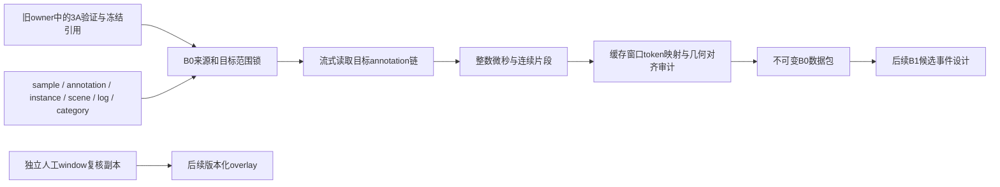

# Phase 3B / B0：真实时钟、目标track与窗口映射设计

日期：2026-11-16。状态：按用户“继续”指令推进已说明的B0a范围，详细实现计划先于代码。实际数据审计见[3B准备报告](../../SCENARIO_EVALUATION_3B_PREPARATION.md)。本设计仅覆盖B0装配，不把事件抽取、人工导入、合成场景及新训练混成一个开发任务。

## 目标与验收对象

为后续canonical候选事件提供可追溯的绝对时钟和完整GT track。输入是既有nuScenes元数据、原fit/select目标缓存及冻结3A证据；输出是带整数微秒、annotation/sample token、可观察连续片段和窗口映射的数据包。本阶段不抽取驾驶事件、不计算新模型指标、不训练、不评价holdout。

第一里程碑B0a只处理3A已有461目标instance，期望16,010条annotation、608个可对齐窗口；通过后B0b扩到原缓存1265 fit＋702 select目标，预期60,948条annotation。不能因允许log内有33,953个对象就扩大目标范围。日志角色由原缓存确定，未分配log和holdout不进入目标装配。

## 路径与冻结隔离

新增分支`feature/scenario-episodes`，worktree放在旧工作区的兄弟目录`../scenario-episodes`（即仓库主目录下`.worktrees/scenario-episodes`），以本设计提交为基点。旧 `.worktrees/scenario-evaluation` 的源码与3A产物保持只读。

3A冻结扫描该worktree全部src/scripts/config，直接在原worktree添加3B模块会使冻结失效。因此新代码不能写入旧工作区；也不能在新worktree直接import旧verify函数就假定父验证正确。父实验证明应在显式指定的旧owner/cwd/PYTHONPATH下调用原CLI一次，保存stdout及绑定引用；后续只核对原owner冻结源码、完成凭据、产物和原始输入快照，不按窗口反复启动父验证。

## 方案比较

| 方案 | 取舍 |
|---|---|
| **推荐：完整目标track＋原始sample时间＋结构性缺口分段** | 来源可复查，不把窗口边缘当事件边缘，为后续状态机提供统一轨迹；需新增装配器 |
| 有限跨度/完全链接的窗口候选聚类 | 可作为探索性对应关系，但不能解决窗口删失、stop/restart屏障或未覆盖事件；不作为canonical定义 |
| onset相近的传递闭包 | 实现简单，但0/0.8/1.6秒会串链合并多个事件；按已批准上位协议拒绝 |

## 数据流与接口边界

GT装配模块不能被预测输入构建器导入。人工资料与旧模型排名隔离；这条链不拼接或重算原始P。

## B0数据契约

### 来源与目标选择

绑定六类元数据的路径、大小、SHA256，原缓存manifest/archive、角色log集合、目标instance集合、旧owner和3A顶层身份。B0a/B0b scope分别写入身份，不把pilot覆盖结果冒称全部目标已验证。

读取583MB annotation表必须分块，保存目标记录而非全表对象，内存与目标数量及缓冲上限相关。当前环境无ijson；首选经过测试的标准库增量JSON数组读取器，不为本阶段下载大型依赖。必须拒绝截断、错误分隔符、非对象元素和尾随数据，不能通过宽松解析静默跳行。

### track与时间

按instance表的first_annotation_token沿next构建完整链，核对prev互反、last_token、nbr_annotations、token唯一性、sample唯一性与scene/log角色。不得先按时间排序后掩盖断链或循环。

时间字段使用sample.timestamp的int64微秒；先做整数相减再转秒，禁止用anchor＋step×500000代替实际时钟。保留actual_dt_us、nominal_step和actual_offset_us，明确nominal_time_is_exact=false。B0不重采样、不插值、不添加缺失观测、不将重复位置当新测量。

若相邻annotation对应的sample不互为scene sample的next/prev，则断开为新的annotation连续片段，记录缺口。时间不递增、跨scene/log/角色、循环或关键外键损坏属于输入完整性错误，整次失败；正常缺帧属于可解释缺口，不删除或跨越平滑。B0不添加未经冻结的时间差阈值来强切相邻sample，记录全部实际dt供B1另行定义。

### 坐标与窗口映射

track保留world XY float64、原rotation、sample/annotation token及scene/log。每个窗口关联anchor annotation、4个历史和12个未来token及实际时间。B0a必须复现已审计608窗口的float32 anchor/history/future，最大坐标差为0；使用原坐标转换精度路径，不能拿已舍入的anchor_yaw逆造原始转换。

按role保存扁平数组：timestamp_us:int64[N]、world_xy:float64[N,2]、rotation:float64[N,4]、annotation/sample/instance_token:Unicode32[N]、segment_id:Unicode64[N]、actual_dt_us:int64[N]及delta_valid:bool[N]。片段首点dt填0但delta_valid=false，不冒充零时长有效间隔。元数据索引保留scene/log/category和每条track的行范围。

窗口映射保存annotation_token[W,17]、sample_token[W,17]、actual_timestamp_us:int64[W,17]、actual_offset_us:int64[W,17]及nominal_step:int16[17]（−4至12）。坐标系和单位明确区分world/meters与原窗口anchor_agent_y_forward；token始终作为字符串，不转换成整数。

正常track断段不允许被窗口映射隐藏。缓存窗口缺anchor或几何不一致是来源错误，终止；无足够上下文的非缓存候选窗口单列not_evaluable/reason，不补GT。片段数只表示标注链连续性，不是物理事件数。

### 稳定片段ID

ID由schema版本、dataset release、track语义哈希、role/log/scene/instance及片段首尾annotation token做规范化哈希；保存首尾时间作为独立字段，不按秒取整生成ID。track语义哈希包含类别和按链顺序规范化的annotation/sample token、prev/next、整数时间、XY及rotation，不包含文件路径、JSON空白或表行顺序。原始文件SHA256另作来源快照，不混入需要行序无关的片段ID。

因此仅重排输入行不改变片段ID，但会改变本次输入快照身份；release、语义数据或边界变化必须改变ID。重排原始3A绑定文件仍会被父来源检查拒绝，不能借语义等价绕过旧冻结。输出按role/log/scene/instance及链顺序固定排序。后续episode ID另外绑定事件规则版本和onset/confirmation/end边界token，B0不预先制造episode。

## 产物与失败状态

建议模块分别负责流式表读取、目标/链装配、窗口几何映射、来源与发布；单文件不混入模型评分或前端。候选路径为 `data/metadata_stream.py`、`analysis/track_timeline.py`、`evaluation/scenario_tracks.py`，CLI为 `scripts/prepare_scenario_tracks.py`；详细任务和测试顺序在设计获准后编写。

产物包括protocol/run/source_refs、目标/角色索引、按role的track数组、片段与缺口表、窗口token/时钟映射、audit及最后写入的completed。源路径都需明确owner；输出存在则拒绝覆盖，失败保留进度而无完成标记。verify-only从原始元数据重建链与映射并检查计数守恒、dtype、坐标和ID，不只读取summary。

## 必须覆盖的边界

- JSON跨块字符串/对象、合法空表、错误逗号、截断、尾随数据。
- 缺元数据/目标instance、重复token、重复instance/sample、循环、prev/next不互反、计数与首尾不符。
- 时间倒序/重复、整数溢出、相邻sample非精确0.5秒、annotation跳过中间sample。
- 首尾只有一个点、无历史/未来的删失边界、role/log/scene或类别不符。
- 坐标变换精度路径、anchor缺失、不同instance共sample、行顺序变化但ID不变。
- 运行中输入/源码改变、已有输出、中断、文件缺失/篡改；失败不签发completed。

合成极小夹具先验收上述错误，再验证真实B0a的461 tracks/16,010 annotation/608窗口和4个缺口；465连续片段可作为当前数据快照的审计预期，不能硬编码成算法常量。B0b再扩到1967目标并核对新范围，最终数以实际完整性验证为准。

## 后续阶段的明确限制

1. **B1是新的候选事件协议**：基于完整片段和实际dt定义速度/加速度、停止/重启、方向段与删失；不能把S4d窗口内最大方向段直接套整条track当一个S/U事件，也不能按时间近邻合并。规则与ID需独立冻结后再抽取。
2. **人工overlay独立**：现有75阳性window任务可并行复核，但不支持召回率；未复核absent不是人工阴性。窗口确认不自动升级episode确认，存在冲突应显式标记。
3. **不拼接3A预测**：旧噪声键含instance/sample，重叠窗口各有不同噪声历史和滤波初始化，不能把不同窗口P串成一次连续驾驶。后续episode评测需另冻结anchor/覆盖/噪声命名空间或重新生成因果观测与候选；无可用anchor的事件必须报告未覆盖。
4. **真实1秒不等于两采样步**：B0只提供真实时钟，不把旧名义slot改称严格物理lead。若未来要求精确物理时域，需另定义目标匹配、时间容差和缺失分母；不得用插值GT伪称高频真值。
5. 停车误差、受控解析运动、遮挡恢复和学习缺失mask分开推进。当前不新增训练、传感器、Cosmos、数据下载或holdout使用。
